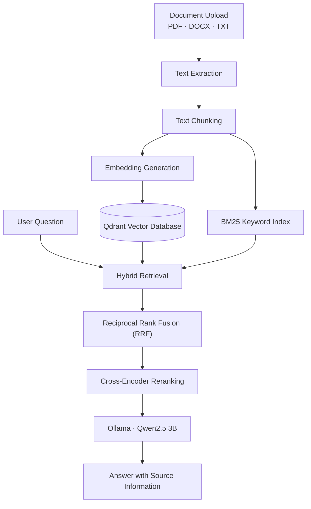

# Internal Docs Hybrid Search RAG

A Retrieval-Augmented Generation (RAG) system that answers questions using information retrieved from uploaded documents.

## Features

- Upload PDF, DOCX, and TXT documents
- Extract and chunk document text
- Generate embeddings using Sentence Transformers
- Store vectors in Qdrant
- Perform dense vector search and BM25 keyword search
- Combine results using Reciprocal Rank Fusion (RRF)
- Rerank passages using a cross-encoder
- Generate context-based answers using Qwen2.5 3B through Ollama
- Return source metadata with answers
- Manage documents through a FastAPI REST API

## Architecture

The system combines dense vector search and BM25 keyword search to retrieve relevant document passages, merges the results using Reciprocal Rank Fusion (RRF), and reranks them before generating an answer with Ollama.




## Tech Stack

Python · FastAPI · Qdrant · Sentence Transformers · BM25 · RRF · Cross-Encoder · Ollama · Docker

## Prerequisites

- Python 3.10
- Git
- Docker Desktop
- Ollama

## Setup

### 1. Clone the repository

Replace the placeholder URL with your GitHub repository URL.

```bash
git clone https://github.com/alentp680/internal-docs-rag.git
cd internal-docs-rag
```

### 2. Create a virtual environment

```powershell
python -m venv .venv
.\.venv\Scripts\Activate.ps1
```

### 3. Install dependencies

Install the CPU versions of PyTorch first:

```powershell
python -m pip install torch==2.6.0+cpu torchvision==0.21.0+cpu torchaudio==2.6.0+cpu --index-url https://download.pytorch.org/whl/cpu
```

Then install the project requirements:

```powershell
python -m pip install -r requirements.txt
```

### 4. Start Qdrant

```powershell
docker compose up -d
```

### 5. Start Ollama

```powershell
ollama pull qwen2.5:3b
```

Make sure Ollama is running before querying the API.

### 6. Start FastAPI

```powershell
uvicorn app.main:app --reload
```

Open the API documentation at http://127.0.0.1:8000/docs.

## API Endpoints

| Method | Endpoint | Purpose |
|---|---|---|
| GET | `/health` | Health check |
| POST | `/documents/upload` | Upload a document |
| GET | `/documents` | List documents |
| DELETE | `/documents/{filename}` | Delete a document |
| POST | `/query` | Ask a question |

## Current Status

The hybrid retrieval and question-answering pipeline has been implemented and tested with sample documents.

Planned improvements include context sufficiency evaluation, self-healing retrieval, and broader system evaluation.

## Security

- Never commit `.env` files, API keys, passwords, or private documents.
- Uploaded documents and local processed data are excluded through `.gitignore`.
- Only process documents you are authorized to use.

## Disclaimer

This is a learning and development project. Answer quality depends on the retrieved context and model behavior.